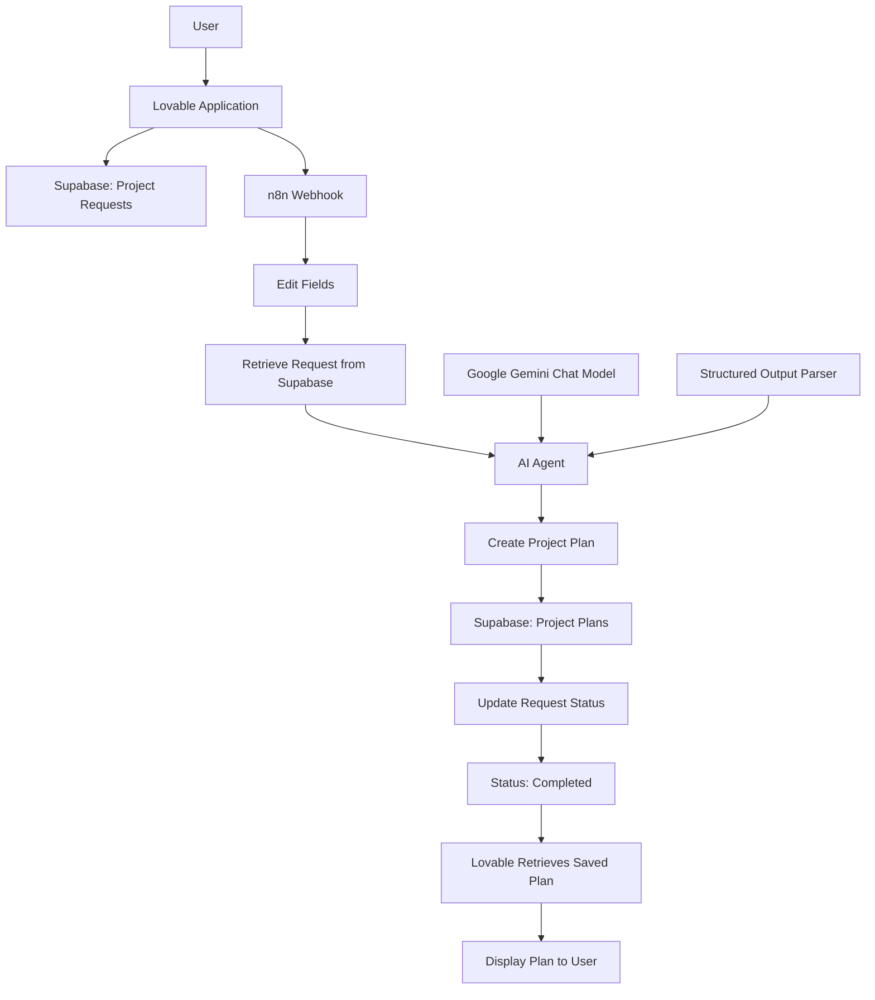

# PlanCraft AI — Build, Connect, Automate

**Turn your ideas into actionable plans.**

PlanCraft AI is an AI-powered project planning application that transforms project ideas into structured, practical action plans. It connects a web application, a database, and an AI automation workflow to create, store, and display project plans.

The project demonstrates how AI tools and system integration can work together to build a complete application.

---

## 📌 Project Overview

Planning a project can be difficult when the idea is not organized into clear goals, tasks, stages, and deadlines.

PlanCraft AI helps users organize their ideas and generate a structured plan using Artificial Intelligence.

Users enter their project details, submit the request, and receive a generated plan that can include:

- Project summary
- Main goal
- Implementation stages
- Suggested actions
- Potential risks and mitigation strategies
- Estimated implementation timeline

AI-generated plans are suggestions that users should review and adjust according to their actual needs and resources.

## 🎯 Project Objectives

The main objectives of this project are to:

- Build an AI-powered web application using a no-code/AI-assisted development tool.
- Integrate a web application with an external automation workflow.
- Store project requests and generated plans in a database.
- Use an AI Agent to generate structured planning results.
- Transfer data between systems using HTTP requests and JSON.
- Manage request processing and completion status.
- Test the complete application workflow.
- Identify integration errors and improve data reliability.

## 🛠️ Tech Stack

| Technology | Purpose |
|---|---|
| **Lovable** | Building the application interface and user experience |
| **Supabase** | Database and persistent data storage |
| **n8n Cloud** | Workflow automation and system integration |
| **Google Gemini** | AI model used by the AI Agent |
| **Webhook** | Receiving HTTP requests from the application |
| **Structured Output Parser** | Producing structured AI output |
| **GitHub** | Source code hosting and project documentation |

## 🏗️ System Architecture

PlanCraft AI consists of three main layers.

### 1. Application Layer — Lovable

The frontend provides the interface where users can:

- Enter a project title and description.
- Add the main goal and additional context.
- Submit a project planning request.
- View previously saved plans.
- Review the processing status and generated results.

### 2. Data Layer — Supabase

Supabase stores the information required by the application.

The project uses two main tables:

- `project_requests`: Stores the user's project information and request status.
- `project_plans`: Stores the generated project plans.

The relationship between requests and plans allows the application to retrieve the result associated with a specific request.

### 3. Automation Layer — n8n Cloud

n8n coordinates the plan generation process.

The workflow includes:

- Webhook
- Edit Fields
- Supabase — Get All / Retrieve Request Data
- AI Agent
- Google Gemini Chat Model
- Structured Output Parser
- Supabase — Create a Row
- Supabase — Update a Row
- Respond to Webhook

The workflow receives a request, retrieves the relevant project information, generates a plan, saves the result, and updates the request status.

---

## 🔄 Workflow and Data Flow

The application follows this process:

1. **User Input:** The user enters the project details in Lovable.
2. **Request Storage:** The project request is stored in Supabase.
3. **Workflow Trigger:** The application sends an HTTP POST request to the n8n Webhook.
4. **Data Preparation:** The Edit Fields node prepares the incoming request data.
5. **Request Retrieval:** The Supabase node retrieves the relevant project request.
6. **AI Processing:** The AI Agent uses Google Gemini to generate a project plan.
7. **Structured Output:** The Structured Output Parser helps organize the AI response into the expected format.
8. **Plan Storage:** The generated plan is saved in the `project_plans` table.
9. **Status Update:** The corresponding request is updated to indicate completion.
10. **Result Display:** The application retrieves and displays the saved plan.

### Workflow Diagram

*Note: The diagram represents the intended end-to-end process. The actual execution order and response behavior should be verified against the implemented workflow.*

## 🗄️ Database Design

### `project_requests`

Stores the original project request and its processing information.

Example fields may include:

| Field | Purpose |
|---|---|
| `id` | Unique request identifier |
| `title` | Project title |
| `description` | Project description |
| `main_goal` | Main project objective |
| `additional_context` | Optional project information |
| `status` | Current processing status |

### `project_plans`

Stores the AI-generated plan.

Example fields may include:

| Field | Purpose |
|---|---|
| `id` | Unique plan identifier |
| `request_id` | Reference to the original request |
| `summary` | Project summary |
| `main_goal` | Main goal |
| `stages` | Implementation stages |
| `actions` | Suggested actions |
| `risks` | Potential risks |
| `timeline` | Estimated timeline |

*The exact field names and data types should match the actual Supabase schema.*

### 🔗 Data Integrity

The `request_id` field connects a generated plan to its original request.

The workflow should ensure that:

- Every plan belongs to the correct request.
- Each request has a clearly defined processing status.
- Duplicate workflow executions do not create unintended duplicate plans.
- Failed operations do not incorrectly mark a request as completed.

---

## 🧠 AI Integration

The AI Agent uses Google Gemini to analyze project information and generate a structured plan.

The Structured Output Parser helps the workflow produce data in a format that can be stored and consumed by the application.

This integration demonstrates how AI can be used beyond a basic chatbot response: the generated output becomes part of a larger application workflow.

AI output should be validated before it is stored or displayed. Estimates, deadlines, and recommendations should not be presented as verified facts unless supported by the supplied information.

## ⚙️ Key Features

- **AI-Powered Planning:** Generates structured project plans from user input.
- **Project Request Management:** Stores submitted project information.
- **Automated Workflow:** Connects the frontend, database, and AI model.
- **Structured AI Output:** Organizes generated information for further processing.
- **Persistent Storage:** Saves generated plans in Supabase.
- **Request Status Management:** Tracks the processing state.
- **Saved Plans:** Displays previously stored plans in the application.
- **System Integration:** Connects multiple tools in a single workflow.

## 🧪 Testing and Quality Assurance

Testing should cover both individual features and the complete application workflow.

### Acceptance Test Scenarios

| ID | Test Scenario | Expected Result |
|---|---|---|
| TC-01 | Submit a valid project request | The request is stored and processed |
| TC-02 | Generate a project plan | The AI returns output in the expected structure |
| TC-03 | Save a generated plan | The plan is stored in Supabase |
| TC-04 | Reload the application | Previously saved plans remain available |
| TC-05 | Open a saved plan | The correct plan and project details are displayed |
| TC-06 | Submit a request with missing required fields | The application prevents submission or displays a clear validation message |
| TC-07 | Send an invalid or incomplete webhook payload | The workflow handles the error without creating incorrect data |
| TC-08 | Simulate an AI or API failure | The request is not incorrectly marked as completed |
| TC-09 | Execute the same request more than once | Duplicate plans are prevented or handled safely |
| TC-10 | Verify the request-to-plan relationship | Each generated plan references the correct request |

### End-to-End Testing

The most important test is to verify the complete process:

**Lovable → Supabase → n8n → AI Agent → Supabase → Lovable**

A successful test should confirm that the generated plan is actually saved in the database and displayed in the application, not merely returned in the workflow execution output.

*Testing results should be documented after executing each scenario against the running application.*

## 🐛 Error Handling and Troubleshooting

Common integration issues to investigate include:

| Issue | Possible Cause | Recommended Check |
|---|---|---|
| Webhook returns an error | Invalid payload or failed workflow node | Inspect the n8n execution logs |
| AI Agent fails | API limits, invalid credentials, or model errors | Check the model configuration and error details |
| Plan is not saved | Database permissions, schema mismatch, or failed insert | Inspect the Supabase node output |
| Duplicate `request_id` error | A plan already exists for the same request | Check the unique constraint and workflow retry behavior |
| Request remains pending | A later workflow step failed or the status was not updated | Inspect the execution path and status-update node |
| Plan is saved but not displayed | Frontend retrieval or request-to-plan mapping issue | Verify the database query and frontend state |
| Incorrect plan is displayed | Request identifiers are mismatched | Trace `request_id` through every workflow step |

### Data Integrity and Duplicate Handling

If `project_plans.request_id` has a unique constraint, attempting to create another plan for the same request may cause a duplicate-key error.

The workflow should handle retries and repeated requests deliberately. Depending on the intended behavior, it can check for an existing plan before inserting, or update the existing plan instead of creating another one.

The database constraint should remain consistent with the application's intended one-plan-per-request behavior.

## 🔐 Security Considerations

- Keep Supabase service-role keys and AI API keys out of frontend code.
- Use appropriate Supabase Row Level Security (RLS) policies.
- Validate incoming webhook payloads.
- Restrict access to workflow endpoints where possible.
- Avoid exposing sensitive database information in error messages.
- Verify that users can access only the data they are authorized to view.
- Use environment variables or secure credential storage for secrets.

Security controls should be verified in the deployed application rather than assumed to be configured.

## 📚 Learning Outcomes

This project provides practical experience with:

- AI-assisted application development
- Frontend and backend integration
- Database design and data persistence
- HTTP requests and Webhooks
- JSON data handling
- n8n workflow automation
- AI Agent configuration
- Structured Output Parser
- API and database error handling
- End-to-end testing
- Data integrity and basic security practices

## 🚀 Future Improvements

Potential improvements include:

- Adding plan editing and regeneration.
- Supporting multiple planning templates.
- Improving progress tracking and error recovery.
- Adding retry logic and duplicate-request protection.
- Allowing users to export plans as PDF.
- Adding clearer processing and failure states.
- Improving authentication and user-specific data access.
- Adding automated integration tests.

## 👩‍💻 Project Author

**Baraa Abu Watfa**

Software Engineer | QA | AI & Automation

This project demonstrates practical work in AI-assisted application development, workflow automation, system integration, database management, and software testing.

## 📌 Project Links

- **Live Application:** https://screenshot-to-spark-044.lovable.app/
- **GitHub Repository:** https://github.com/baraa-abuwatfa/screenshot-to-spark-044.git
- **Workflow Platform:** n8n Cloud
- **Database Platform:** Supabase

---

*PlanCraft AI — From project ideas to structured action plans.*
