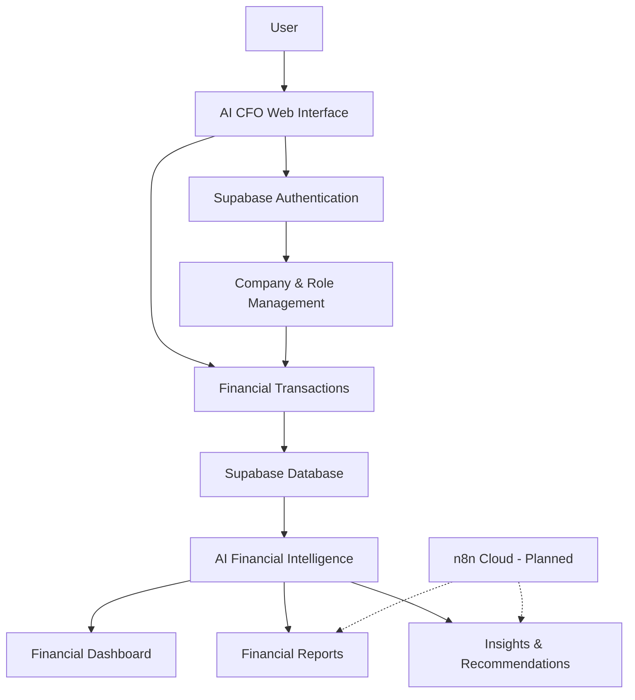
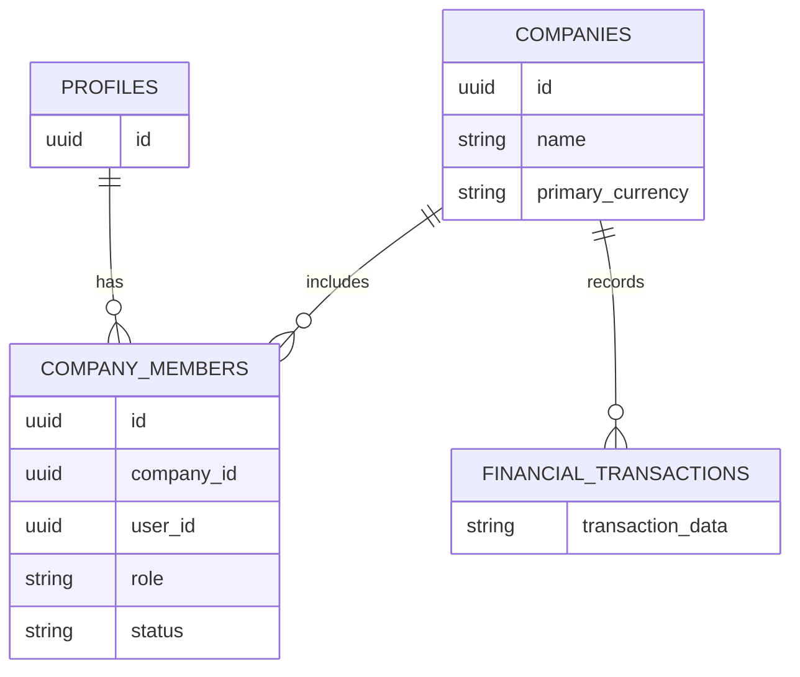
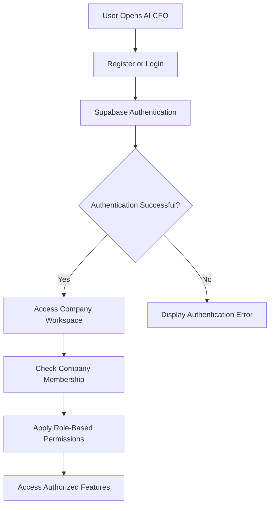
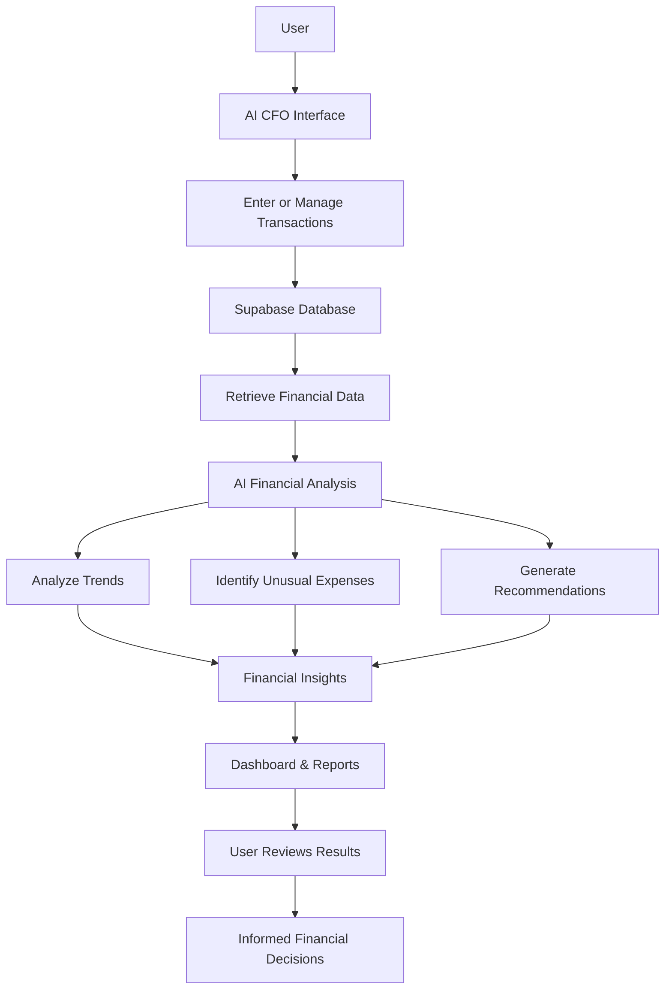
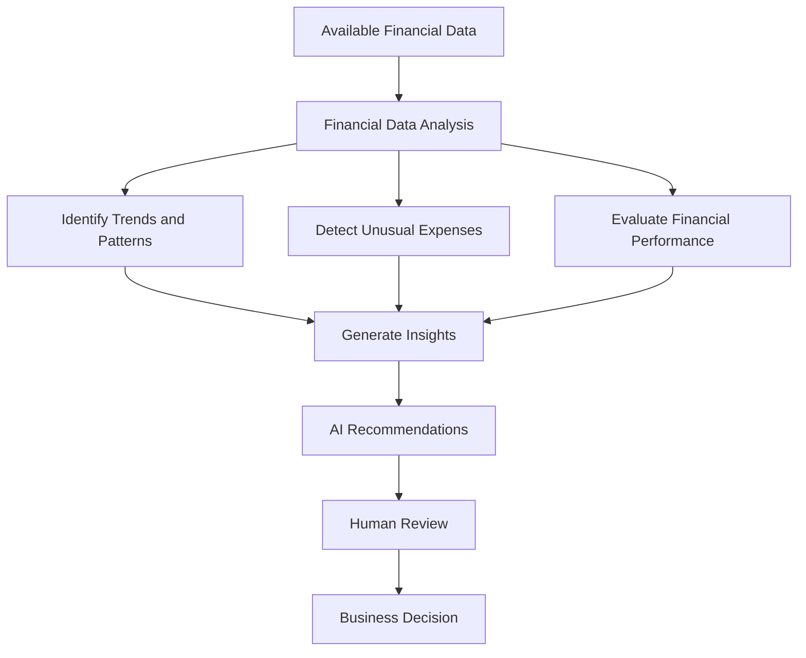
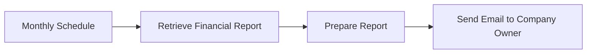
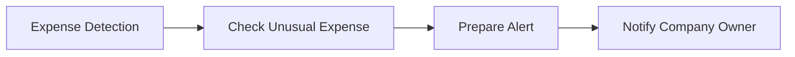

# 🏗️ AI CFO — System Architecture

**Technical Solution | System Design & Architecture**

---

## 1. 🚀 Architecture Overview

AI CFO is a web-based financial intelligence platform built using a modern application architecture that combines an interactive user interface, cloud-based database services, authentication, company-based access management, and AI-powered financial analysis.

The system is designed to help business owners manage financial information, analyze business performance, and access meaningful financial insights through a unified platform.

The architecture is organized into the following main layers:

1. **Presentation Layer:** Provides the user interface and application experience.
2. **Authentication & Access Layer:** Handles user authentication, company membership, and role-based permissions.
3. **Data Layer:** Stores and manages company and financial information.
4. **AI Intelligence Layer:** Analyzes available financial data and generates insights and recommendations.
5. **Automation Layer:** Reserved for future workflow automation using n8n Cloud.

---

## 2. 🗺️ System Architecture Diagram

The following diagram illustrates the main system components and their relationships.

### Architecture Notes

- Lovable is used to develop the application interface.
- Supabase provides authentication and database services.
- Company membership and roles support controlled access to company data.
- AI Financial Intelligence processes available financial information to produce insights.
- n8n Cloud represents a planned future integration, not an implemented component of the current prototype.

---

## 3. 🧩 System Components

| Component | Technology / Service | Responsibility |
|---|---|---|
| Web Application | Lovable | Application interface and user interaction. |
| Authentication | Supabase Auth | User registration and login. |
| Company Management | Supabase | Company records, membership, and roles. |
| Database | Supabase PostgreSQL | Stores application and financial data. |
| Access Control | Supabase RLS | Restricts access to data according to configured policies. |
| AI Intelligence | AI Integration | Financial analysis, unusual expense detection, and recommendations. |
| Workflow Automation | n8n Cloud | Planned automation for future development. |

---

## 4. 🛠️ Technology Architecture

### 4.1 Lovable — Application Interface

Lovable is used as the AI-assisted application development platform.

Main responsibilities:

- Building the AI CFO web interface.
- Presenting financial dashboards and reports.
- Providing transaction management screens.
- Supporting navigation between application modules.
- Connecting the application interface with backend services.

### 4.2 Supabase — Backend Services

Supabase provides the main backend infrastructure used by the prototype.

Main responsibilities:

- User authentication.
- PostgreSQL database management.
- Company and membership data storage.
- Role-based access management.
- Row Level Security policies.

### 4.3 AI Financial Intelligence

The AI integration provides the intelligence capabilities of the platform.

Main responsibilities:

- Analyzing available financial information.
- Identifying financial trends and patterns.
- Highlighting unusual expenses for review.
- Supporting financial recommendations.

The AI layer is intended to transform financial records into useful information that supports business decision-making.

> «The specific AI provider, model, and implementation endpoint are not documented in this architecture because their exact technical configuration has not been confirmed.»

### 4.4 n8n Cloud — Future Automation

n8n Cloud is planned as an automation service for two future workflows:

| Planned Workflow | Description | Status |
|---|---|---|
| Monthly Financial Report | Retrieve the monthly financial summary and email it to the company owner. | Planned |
| Unusual Expense Alert | Notify the company owner when an unusual expense is detected through email or Telegram. | Planned |

These workflows are not currently implemented in the working prototype.

---

## 5. 🗄️ Database Architecture

AI CFO uses Supabase PostgreSQL to store and manage application data.

The confirmed database structure includes the following main entities:

| Database Entity | Purpose |
|---|---|
| `profiles` | Stores user profile information. |
| `companies` | Stores company information and settings. |
| `company_members` | Connects users to companies and stores membership roles and status. |
| Financial Transactions | Stores the financial records used by the application. |

### 🔗 Logical Database Relationships

> **Important:** This is a logical representation of the known data relationships, not a complete physical database schema. Exact transaction table names, columns, keys, and constraints should be documented from the actual Supabase database structure.

### 🏢 Company-Based Data Management

The platform follows a company-based data organization approach.

- Users can belong to companies through company membership records.
- Each membership has an assigned role.
- Company-related financial information is organized within its company context.
- Access restrictions are supported through configured Row Level Security policies.

---

## 6. 🔐 Authentication & Authorization

AI CFO uses Supabase Authentication for user identity management and company-based roles to control access to application features.

### Authentication Flow

### Role-Based Access

| Role | Access Description |
|---|---|
| Owner | Full company access and management. |
| Admin | Administrative access according to configured permissions. |
| Finance Manager | Financial data management and analysis according to permissions. |
| Viewer | Read-only access to financial information. |

### Row Level Security (RLS)

Supabase Row Level Security is used to support data access restrictions.

Its purpose is to help ensure that users can access company information according to their membership and configured permissions.

---

## 7. 🔄 Data Flow Architecture

The following diagram describes the logical flow of financial information through the platform.

### Data Flow Explanation

1. The user accesses the application.
2. Authorized users enter or manage financial transactions.
3. Financial records are stored in the Supabase database.
4. Available financial data is used by the financial analysis capabilities.
5. The system presents financial trends, unusual expenses, and recommendations.
6. Users review the results through the dashboard and reports.
7. Business owners use the information to support financial decisions.

---

## 8. 🧠 AI Integration Architecture

AI is a central part of the AI CFO solution.

Unlike a traditional financial dashboard that only displays numerical information, AI CFO aims to help users understand financial performance through intelligent analysis.

### AI Processing Capabilities

| Capability | Purpose |
|---|---|
| Financial Trend Analysis | Understand changes in revenue and expenses. |
| Period Comparison | Compare financial performance across periods. |
| Unusual Expense Detection | Highlight expenses that may require further investigation. |
| Category Analysis | Identify spending patterns across categories. |
| Financial Recommendations | Provide data-based suggestions to support decisions. |

### AI Decision-Support Flow

### Human Review Principle

AI-generated insights are intended to support financial decision-making. They do not replace human judgment, professional accounting, or financial advice.

---

## 9. 🛡️ Security & Data Protection

Security is an important consideration in the system architecture.

The current implementation includes:

- Supabase Authentication for user access.
- Company membership and role management.
- Supabase Row Level Security policies.
- Role-based permissions for financial operations.
- Company-based organization of financial information.

### Security Considerations

The following areas should be reviewed and validated before production deployment:

- Database access policies and company data isolation.
- Authentication session handling.
- Protection of sensitive financial information.
- Secure management of application credentials and API keys.
- Backup and recovery procedures.
- Production deployment security configuration.

> «The listed considerations are validation requirements and should not be interpreted as proof that every production-level security control has already been implemented.»

---

## 10. ⚙️ Future Automation Integration

The architecture allows for future integration with n8n Cloud to automate selected financial follow-up activities.

### Planned Workflow 1 — Monthly Financial Report

### Planned Workflow 2 — Unusual Expense Alert

**Status:** Both workflows are planned for future development and are not currently part of the implemented prototype.

---

## 11. 📌 Architecture Summary

| Layer | Main Component | Current Status |
|---|---|---|
| Presentation | Lovable Web Application | Implemented |
| Authentication | Supabase Auth | Implemented |
| Company Management | Supabase | Implemented |
| Database | Supabase PostgreSQL | Implemented |
| Access Control | Supabase RLS | Implemented |
| Financial Intelligence | AI Integration | Implemented in the prototype |
| Workflow Automation | n8n Cloud | Planned |

---

## 🎯 Conclusion

The AI CFO architecture combines web application development, cloud database services, authentication, company-based access management, and AI-powered financial intelligence.

This architecture provides the foundation for managing financial records, analyzing business performance, and presenting meaningful insights through a unified platform.

Future integration with n8n Cloud is expected to extend the platform with automated financial reporting and unusual expense notifications.

**AI CFO — From Financial Data to Intelligent Decisions.**

---

**AI CFO | System Architecture Documentation | 2026**
