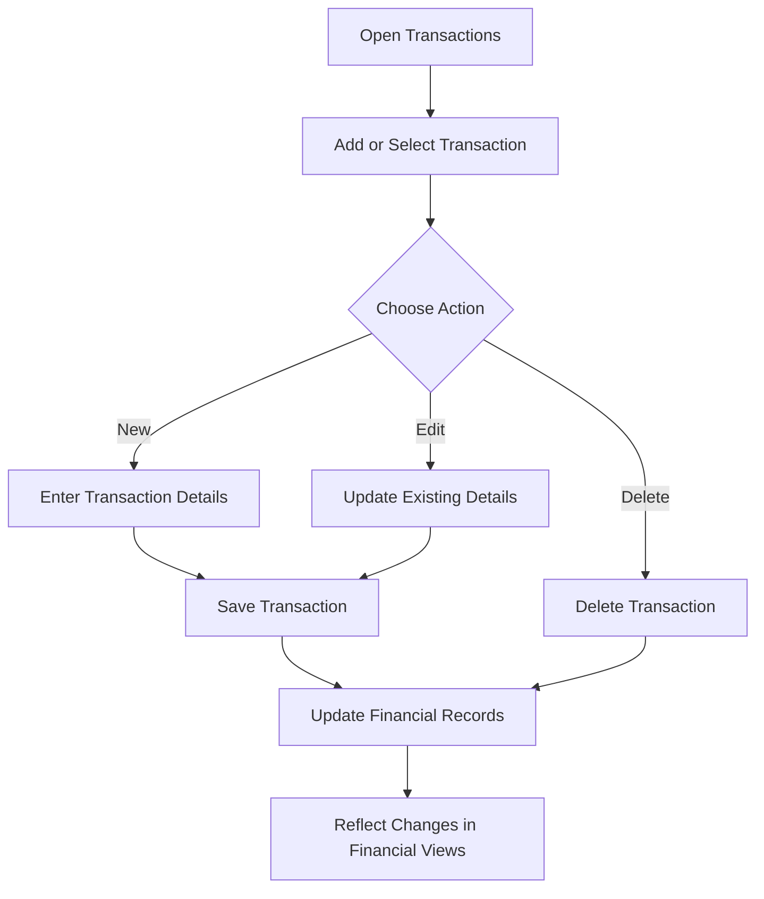
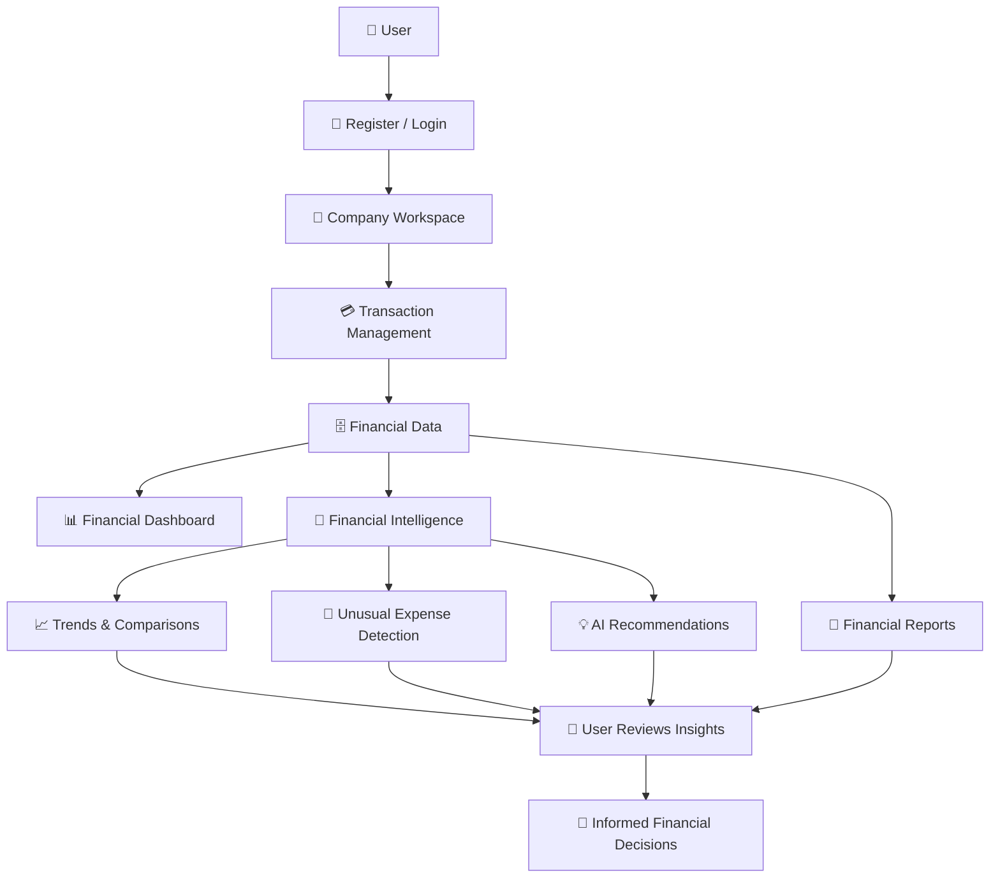

# 💻 AI CFO — Working Prototype

**Technical Solution | Prototype Overview & Functional Capabilities**

---

## 1. 🚀 Prototype Overview

The AI CFO Working Prototype is a web-based financial intelligence application designed to help small business owners and entrepreneurs manage financial information, monitor business performance, and gain meaningful insights from their financial data.

The prototype combines financial management capabilities with AI-powered analysis in one platform.

It demonstrates the core user journey, from accessing a company workspace and recording transactions to reviewing financial reports and AI-generated recommendations.

### Prototype Objectives

- Demonstrate the main functionalities of AI CFO.
- Provide an integrated financial management experience.
- Transform transaction records into understandable financial insights.
- Support business owners in making informed financial decisions.

---

## 2. 🧩 Implemented Prototype Modules

The prototype includes the following main modules:

### 🔐 2.1 Authentication & Company Management

Provides user access and company-based workspace management.

Implemented capabilities:

- User registration and login.
- Company setup.
- Company membership management.
- Role-based access permissions.

#### Supported User Roles

| Role | Access Level |
|---|---|
| Owner | Full company access and management. |
| Admin | Administrative access according to assigned permissions. |
| Finance Manager | Financial data management and analysis. |
| Viewer | Read-only access to financial information. |

### 📊 2.2 Financial Dashboard

The dashboard provides a summarized view of the company's financial performance.

#### Main Financial Indicators

| Indicator | Description |
|---|---|
| Revenue | Total income recorded during the selected period. |
| Expenses | Total recorded business expenses. |
| Net Profit | Difference between revenue and expenses. |
| Cash Flow | Overview of money flowing into and out of the business. |

**Purpose:** To help users quickly understand their financial position without manually reviewing every transaction.

### 💳 2.3 Transaction Management

This module allows authorized users to manage the company's financial records.

Implemented capabilities:

- Add income and expense transactions.
- Edit existing transactions.
- Delete transactions.
- Assign transaction categories.
- Record transaction dates and descriptions.
- Search and filter financial records.

#### Transaction Workflow



### 🧠 2.4 Financial Intelligence

This is one of the core features of AI CFO.

It analyzes available financial transaction data and presents insights that help users understand business performance.

#### Implemented Capabilities

| Feature | Function |
|---|---|
| Financial Trend Analysis | Analyzes revenue and expense trends. |
| Period Comparison | Compares financial performance across different periods. |
| Unusual Expense Detection | Highlights expenses that may require further review. |
| Category Analysis | Examines spending patterns across expense categories. |
| AI Recommendations | Provides recommendations based on available financial data. |

**Expected User Experience:** The user explores financial insights, reviews identified patterns, and uses the recommendations as supporting information when making decisions.

> «AI-generated recommendations are decision-support outputs. Users remain responsible for reviewing findings and making final decisions.»

### 📑 2.5 Financial Reports

The Financial Reports module presents organized financial summaries for reviewing business performance.

Implemented capabilities:

- Monthly financial summaries.
- Annual financial summaries.
- Revenue and expense summaries.
- Net profit calculations.
- Profit margin indicators.
- Financial tables and visual charts.

**Report Purpose:** To make financial performance easier to review and help business owners understand changes over time.

---

## 3. 🔄 Complete Prototype Workflow

The following flow illustrates how the main modules work together:



---

## 4. 🏗️ Prototype Technology

The working prototype uses the following technologies:

| Technology | Role in the Prototype |
|---|---|
| Lovable | AI-assisted development of the web application and user interface. |
| Supabase Authentication | User registration and authentication. |
| Supabase Database | Storage and management of company and financial data. |
| Supabase Row Level Security (RLS) | Supports company-based data access restrictions. |
| AI Integration | Financial analysis, unusual expense detection, and recommendations. |

### Automation Status

n8n Cloud is planned for future integration. The two proposed workflows are not part of the current implemented prototype:

- 📧 Monthly Financial Report Email.
- 🚨 Unusual Expense Alert.

---

## 5. 🖥️ Prototype Screenshots & Evidence

The following screenshots can be added to demonstrate the actual application interface and its main functionalities.

| Screenshot | What It Demonstrates |
|---|---|
| `01-login.png` | User authentication interface. |
| `02-dashboard.png` | Main financial dashboard and indicators. |
| `03-transactions.png` | Transaction management interface. |
| `04-financial-intelligence.png` | Financial analysis and AI recommendations. |
| `05-financial-reports.png` | Monthly and annual financial reports. |
| `06-company-management.png` | Company setup and membership management, if available. |

### 📂 Suggested GitHub Folder

```text
02_Technical_Solution/
├── WORKING_PROTOTYPE.md
└── screenshots/
    ├── 01-login.png
    ├── 02-dashboard.png
    ├── 03-transactions.png
    ├── 04-financial-intelligence.png
    ├── 05-financial-reports.png
    └── 06-company-management.png
```

Replace the suggested screenshot filenames with actual captured images. Include only screens that exist in the current application.

---

## 6. 🌐 Prototype Access

| Item | Link |
|---|---|
| Live Application | [Add deployed application URL] |
| GitHub Repository | [Add repository URL] |
| Video Demonstration | [Add video URL] |

### Access Instructions

1. Open the deployed application.
2. Register or log in.
3. Create a company workspace or access an existing one.
4. Navigate through the dashboard and financial modules.
5. Add financial transactions to explore the analysis and reporting features.

Access depends on the availability of the deployed application and its connected services.

---

## 7. ⚠️ Prototype Limitations

The current prototype demonstrates the core financial management and intelligence capabilities, but it has some limitations:

- AI analysis depends on the availability and quality of transaction data.
- Unusual expense detection identifies items that may require review; it does not establish fraud or financial misconduct.
- AI recommendations should be reviewed before being used in business decisions.
- The prototype does not replace professional accounting or financial services.
- Automated monthly email reports and unusual expense notifications through n8n are planned, not implemented.
- Production readiness, scalability, and long-term performance require further validation.

---

## 8. 🎯 Prototype Outcome

The AI CFO prototype demonstrates how financial management and AI-powered analysis can be combined in one application.

It moves beyond basic financial recordkeeping by helping users:

- Monitor financial performance.
- Manage income and expenses.
- Understand financial trends.
- Identify unusual expenses for review.
- Explore AI-generated recommendations.
- Review monthly and annual financial reports.

**AI CFO — From Financial Records to Meaningful Insights.**

---

<sub>AI CFO | Working Prototype Documentation | 2026</sub>
