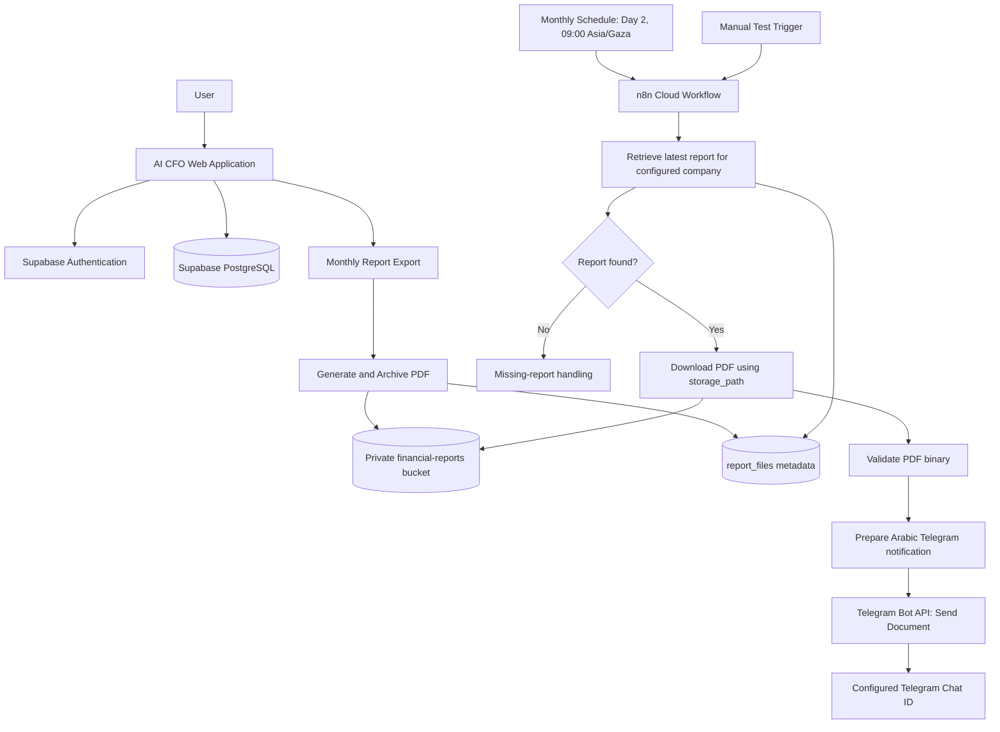

# 🏗️ AI CFO — System Architecture

## 1. Architecture Overview

AI CFO combines a web application, Supabase backend and storage, financial analysis features, and an n8n Cloud workflow that retrieves and delivers archived monthly report PDFs through Telegram.

The application generates and archives a monthly report PDF when a user exports it. n8n orchestrates retrieval and delivery; it does not generate the PDF.

## 2. System Architecture Diagram

## 3. Monthly Telegram Automation Components

| Component | Responsibility |
|---|---|
| AI CFO application | Generates and archives the PDF when a user exports a monthly report. |
| n8n Cloud | Runs scheduled or manual workflow and orchestrates lookup, retrieval, validation, and delivery. |
| Supabase PostgreSQL | Stores report metadata in `report_files`. |
| Supabase Storage | Stores PDF in private `financial-reports` bucket. |
| `storage_path` | Metadata column containing the actual archived object path. |
| Telegram Bot API | Sends the PDF document and notification to configured Telegram Chat ID. |

### Schedule and Triggers

- Scheduled trigger: monthly, day 2 at 09:00, timezone `Asia/Gaza`.
- Manual trigger: Manual Test Trigger for controlled testing.

### Workflow Sequence

1. Load workflow configuration, including the configured company and destination chat.
2. Retrieve the latest monthly report metadata for that company from `report_files`.
3. Check whether a report record was found; handle the missing-report path without attempting an invalid download.
4. Read the actual `storage_path` column and download the PDF from the private `financial-reports` bucket using authorized Supabase access.
5. Validate that the downloaded binary is present and is a PDF before sending.
6. Prepare a professional Arabic Telegram notification.
7. Send the actual document through the Telegram Bot API to the configured Chat ID.

## 4. Data and Storage Architecture

The project uses Supabase PostgreSQL and Supabase Storage. Known application entities include `profiles`, `companies`, and `company_members`. The automation uses the `report_files` metadata table; the storage object path is read from `storage_path`.

| Storage setting | Value |
|---|---|
| Bucket | `financial-reports` |
| Visibility | Private |
| File type | PDF |
| Metadata table | `report_files` |
| Object path column | `storage_path` |

The automation must use authenticated access to private storage. Do not publish a public bucket URL or expose service credentials in client-side code or documentation.

## 5. Authentication, Security, and Privacy

- Use least-privilege Supabase credentials in protected n8n credentials/configuration.
- Keep Telegram bot tokens and Chat IDs out of committed files and screenshots; treat recipient identifiers as configuration data.
- Restrict access to the private bucket and report metadata according to the configured company and required workflow permissions.
- Do not log full report contents, tokens, signed URLs, or sensitive financial data unnecessarily.
- Validate the expected report and binary before sending, and avoid sending a report if company, period, or file validation fails.
- Use synthetic or anonymized information in demonstrations and test evidence.

These are security requirements for the integration; actual policy configuration should be verified in the deployed Supabase and n8n environments.

## 6. Error Handling and Observability

The workflow should handle at least these conditions explicitly:

- No report metadata found for the configured company/period: stop the send path and record a non-sensitive outcome.
- Supabase query or storage download error: fail the run visibly; do not send an empty or stale binary.
- Missing/invalid PDF binary: stop before Telegram delivery.
- Telegram API error or rejected document: mark the run as failed and retain enough non-sensitive execution context for diagnosis.
- Retries, where configured, should avoid duplicate sends or make duplicate behavior clear.

Do not treat a successful query or workflow execution as proof of end-to-end delivery. Confirmation requires receiving and inspecting the actual PDF in the configured Telegram chat.

## 7. Implementation and Verification Status

| Item | Status |
|---|---|
| n8n workflow | Implemented and configured |
| Application-generated PDF archival in Supabase | Successful |
| Supabase report metadata retrieval | Previously successful |
| Telegram document delivery of a real PDF | Pending end-to-end verification |

## 8. Future Changes

The monthly report delivery channel documented here is Telegram. Do not describe this implemented/configured workflow as a future email or SMTP automation. Other automation ideas, if later proposed, must be documented separately and accurately labeled.
