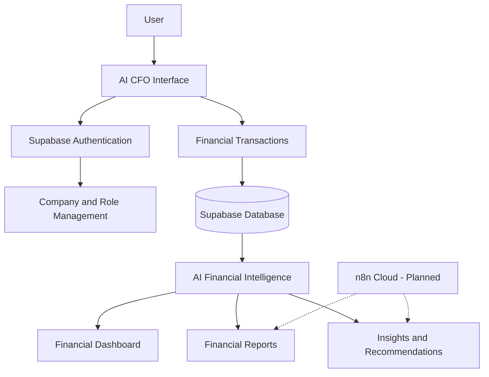
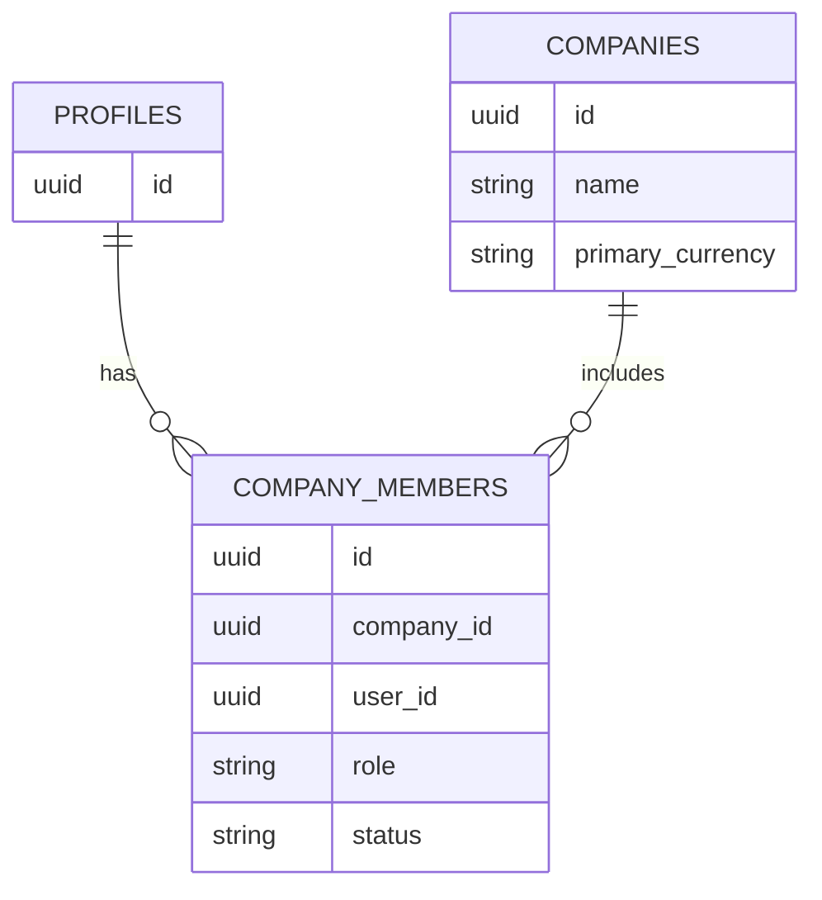

# 🏗️ AI CFO — System Architecture

## 1. Architecture Overview

AI CFO follows a web-based application architecture that combines a user interface, backend services, database management, authentication, and AI-assisted financial analysis.

The architecture is designed to organize company financial data, process transactions, generate financial indicators, and provide insights that support business decision-making.

The main technologies used in the prototype are:

- **Lovable:** Application interface and development.
- **Supabase:** Authentication, database, and backend services.
- **AI Integration:** Financial analysis and recommendations.
- **n8n Cloud:** Planned automation workflows.

## 2. System Architecture Diagram

The following diagram illustrates the main components and their relationships.



> **Note:** The n8n connections represent planned future integrations, not currently implemented workflows.

## 3. System Components

### 3.1 User Interface Layer

The user interface is developed using Lovable. It provides the main interaction points between users and the application.

Main interface modules:

- Authentication pages.
- Company setup and management.
- Financial dashboard.
- Transaction management.
- Financial Intelligence.
- Financial Reports.

### 3.2 Authentication & Backend Layer

Supabase provides backend services for the application.

Its responsibilities include:

- User authentication.
- Company membership management.
- Database operations.
- Access control through Row Level Security (RLS).

### 3.3 Database Layer

Supabase PostgreSQL is used to store application data.

The confirmed database entities include:

| Table | Purpose |
|---|---|
| `profiles` | Stores user profile information. |
| `companies` | Stores company information and settings. |
| `company_members` | Connects users to companies and manages their roles. |

Financial transaction records are also stored in the application's database and are used by the financial features.

> **Note:** The exact transaction table name and its complete column structure should be documented after verification against the current database schema.

### 3.4 AI Financial Intelligence Layer

The AI Financial Intelligence component uses available financial data to support analysis.

Its responsibilities include:

- Analyzing revenue and expenses.
- Identifying financial trends.
- Comparing financial periods.
- Analyzing expense categories.
- Identifying unusual expenses.
- Generating financial recommendations.

The AI component supports users by explaining financial patterns and highlighting potential issues. It does not independently execute financial decisions.

## 4. Technology Architecture

| Layer | Technology | Responsibility |
|---|---|---|
| Frontend | Lovable | User interface and application experience. |
| Backend Services | Supabase | Backend operations and application services. |
| Database | Supabase PostgreSQL | Storing company and financial data. |
| Authentication | Supabase Auth | User registration and login. |
| Authorization | Supabase RLS | Protecting company data and controlling access. |
| Intelligence | AI Integration | Financial analysis and recommendations. |
| Automation | n8n Cloud | Planned email and notification workflows. |

## 5. Database Architecture

The application uses a company-based data structure.

Users can belong to companies through company membership records. Each membership is associated with a role that determines the user's permitted actions.

### Main Relationships



The diagram shows the confirmed company membership structure. Financial transaction relationships are not included here because the exact transaction schema must be verified.

## 6. Authentication & Authorization

Supabase Authentication manages user registration and login.

The application uses company-based roles to control access to financial information.

### Role-Based Permissions

| Role | Access |
|---|---|
| Owner | Full company access and management. |
| Admin | Administrative access according to assigned permissions. |
| Finance Manager | Financial transaction management and financial operations. |
| Viewer | Read-only access to available company information. |

### Security Mechanisms

The system uses:

- Supabase Authentication.
- Row Level Security (RLS).
- Company membership checks.
- Role-based authorization.
- Database-level protection for company membership operations.

These mechanisms help ensure that users can access only the company data and operations permitted by their roles.

## 7. Data Flow

The main data flow follows these steps:

1. The user logs into AI CFO.
2. Supabase verifies the user's authentication.
3. The application identifies the selected company and the user's role.
4. The user adds or manages financial transactions.
5. Financial records are stored in the database.
6. The application retrieves the relevant financial data.
7. Financial calculations and AI-assisted analysis are performed.
8. Results are displayed through the dashboard, reports, and Financial Intelligence interface.
9. The user reviews the results and makes the final decision.

## 8. AI Financial Intelligence

AI Financial Intelligence transforms financial records into meaningful information.

### Input Data

- Income transactions.
- Expense transactions.
- Transaction dates.
- Financial categories.
- Transaction amounts.
- Selected reporting periods.

### Processing

The application uses available financial data to calculate financial indicators and support AI-assisted analysis.

### Output

- Financial performance insights.
- Revenue and expense trends.
- Period comparisons.
- Unusual expense observations.
- Category analysis.
- Financial recommendations.

> **Decision Responsibility:** AI CFO provides decision support. Users remain responsible for reviewing the analysis and making final financial decisions.

## 9. Security & Data Protection

The architecture uses Supabase security features to protect user and company information.

Key measures include:

- Authentication before accessing protected application features.
- Role-based permissions.
- Row Level Security policies.
- Company membership validation.
- Restricted access to company-specific information.

Security configurations should be reviewed and tested whenever database policies or user permissions are changed.

## 10. Future Automation Integration

The architecture allows future integration with n8n Cloud to automate selected financial communication tasks.

Two workflows are planned:

### 10.1 Monthly Financial Report

**Planned flow:**

```text
Schedule Trigger
      ↓
Retrieve Monthly Financial Report
      ↓
Prepare Report Information
      ↓
Send Email to Company Owner
```

**Purpose:** Automatically send the company's monthly financial report to its owner.

### 10.2 Unusual Expense Alert

**Planned flow:**

```text
Expense Trigger
      ↓
Check Unusual Expense
      ↓
Prepare Alert
      ↓
Notify Company Owner (Email or Telegram)
```

**Purpose:** Notify the company owner when an unusual expense is identified.

> **Implementation Status:** Both workflows are planned future integrations. They should not be considered implemented until they are built, connected, and tested successfully.

---

## 11. Architecture Summary

AI CFO uses a modular architecture that connects the user interface, authentication, company management, financial data storage, and AI-assisted analysis.

This structure supports the core financial management features while allowing future expansion through workflow automation.

**AI CFO — Turning Financial Data into Intelligent Decisions.**
