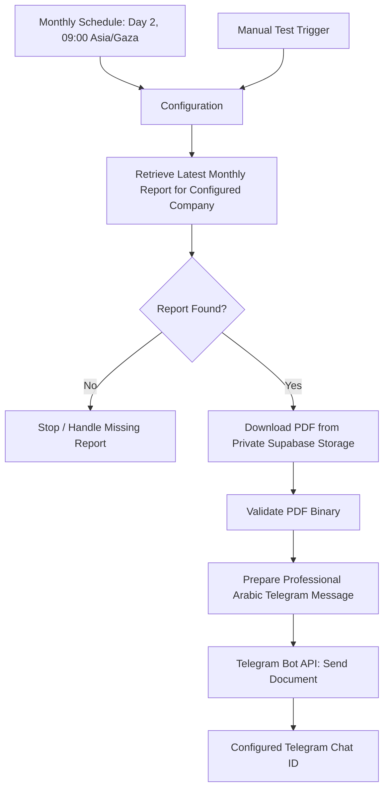

# 🖥️ AI CFO — Working Prototype

## 1. Prototype Overview

AI CFO is an AI-powered financial management platform for organizing financial data, reviewing performance through dashboards and reports, and exploring AI-assisted insights. The prototype also includes an implemented and configured n8n Cloud workflow for monthly report PDF delivery through Telegram.

## 2. Application Features

### Authentication & Company Management

- User registration and login.
- Company setup and membership management.
- Role-based access permissions for Owner, Admin, Finance Manager, and Viewer.

### Financial Dashboard

The dashboard summarizes total revenue, total expenses, net profit, and cash flow using available financial records and visual charts.

### Transaction Management

Authorized users can add, edit, delete, search, filter, and categorize income and expense records.

### Financial Intelligence

The application provides financial trends, period comparisons, expense category analysis, unusual-expense observations, and AI-assisted recommendations based on available data. Users remain responsible for reviewing insights and making decisions.

### Financial Reports

The application provides monthly and annual summaries, revenue and expense totals, net profit and margin indicators, charts, and PDF export. **The application generates and archives the PDF when the user exports a monthly report. n8n retrieves and delivers that archived PDF; it does not generate the PDF.**

## 3. Monthly Financial Report Telegram Automation

The n8n Cloud workflow is implemented and configured to deliver the archived monthly report PDF to the configured Telegram Chat ID.

### Workflow Configuration

| Setting | Configured value / behavior |
|---|---|
| Orchestration | n8n Cloud |
| Schedule | Day 2 of each month at 09:00, `Asia/Gaza` |
| Manual test | Manual Test Trigger |
| Report metadata | Supabase `report_files` table |
| Storage bucket | `financial-reports` (private) |
| Storage path column | `storage_path` |
| File format | PDF |
| Delivery | Telegram Bot API document send |
| Recipient | Configured Telegram Chat ID |
| Notification | Professional Arabic message accompanying the document |

The workflow retrieves the latest monthly report for the configured company. Report creation and archival happen in the application during user export; n8n downloads the archived PDF.

### Implementation and Verification Status

| Capability / evidence | Status |
|---|---|
| n8n workflow implementation and configuration | Implemented and configured |
| Application PDF generation and Supabase archival | Successful |
| Supabase report metadata retrieval | Previously successful |
| Actual PDF received in Telegram end-to-end | Pending verification; do not claim success until confirmed |

## 4. Technology Stack

| Technology | Purpose |
|---|---|
| Lovable | Application interface development |
| Supabase | Database, authentication, report metadata, and private storage |
| AI integration | Financial analysis and recommendations |
| n8n Cloud | Monthly report workflow orchestration |
| Telegram Bot API | PDF document delivery |

## 5. Prototype Access

- **Application:** AI CFO
- **Demo link:** [Add your deployed application URL here]
- **Repository:** [Add the repository URL here]

## 6. Screenshots & Evidence

Add only screenshots from the actual application or workflow. Do not invent evidence or include secrets or real customer financial information.

- `screenshots/login.png` — login interface, if captured.
- `screenshots/dashboard.png` — dashboard, if captured.
- `screenshots/transactions.png` — transaction interface, if captured.
- `screenshots/financial-intelligence.png` — financial analysis, if captured.
- `screenshots/financial-reports.png` — report/export interface, if captured.
- Automation screenshots belong in `../08_Automation/screenshots/` and should show only verified workflow configuration or test evidence.

## 7. Known Limitations

- Financial analysis depends on the completeness and correctness of entered transaction data.
- AI-generated recommendations require user review and do not replace professional accounting or financial advice.
- Telegram delivery must be verified by receiving the actual PDF in the configured chat; this end-to-end result is currently pending verification.
- Automation depends on a report PDF already being generated and archived by the application for the configured company.
- Credentials and bot tokens must be stored as protected n8n credentials or secure configuration, never in source control.

---

**AI CFO — Turning Financial Data into Intelligent Decisions.**
