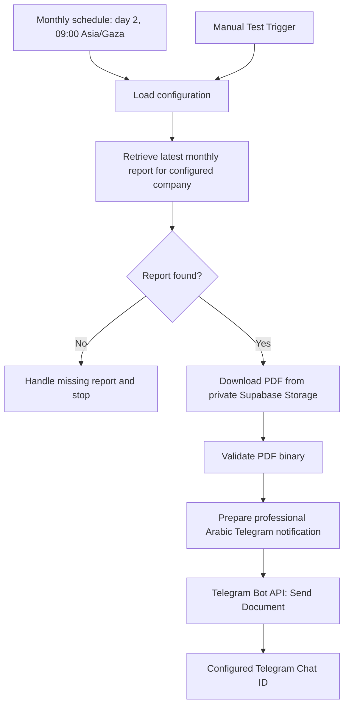

# 📄 Monthly Report Telegram Automation

## Overview

This document describes the existing, implemented, and configured n8n Cloud automation for delivering an AI CFO monthly report PDF through the Telegram Bot API.

The AI CFO application generates and archives the PDF when a user exports a monthly report. n8n does **not** generate the report; it finds and retrieves the archived file, validates it, prepares a professional Arabic notification, and sends the PDF to the configured Telegram Chat ID.

## Workflow at a Glance

## Confirmed Configuration

| Setting | Value |
|---|---|
| Workflow platform | n8n Cloud |
| Scheduled trigger | Monthly, day 2 at 09:00 |
| Timezone | `Asia/Gaza` |
| Manual trigger | Manual Test Trigger |
| Metadata table | Supabase `report_files` |
| Storage path column | `storage_path` |
| Storage bucket | `financial-reports` |
| Bucket visibility | Private |
| File format | PDF |
| Delivery channel | Telegram Bot API |
| Destination | Configured Telegram Chat ID |
| Message | Professional Arabic notification with the PDF document |

## Workflow Steps

1. Start on the monthly schedule or via Manual Test Trigger.
2. Load configured company and Telegram destination settings from protected configuration.
3. Retrieve the latest monthly report metadata for the configured company from Supabase `report_files`.
4. Check the lookup result. If no suitable report exists, stop the delivery path and record a safe, non-sensitive outcome.
5. Read the actual `storage_path` column from the report metadata.
6. Download the corresponding PDF from the private `financial-reports` Supabase Storage bucket using authorized credentials.
7. Validate that a non-empty PDF binary is available before proceeding.
8. Prepare the professional Arabic Telegram notification without exposing unnecessary financial data in message text.
9. Use Telegram Bot API document delivery to send the PDF to the configured Chat ID.
10. Verify the end-to-end outcome by confirming that the actual PDF arrives and opens in the target Telegram chat.

## Responsibility Boundaries

- **Application:** Creates and archives the PDF when a user exports a monthly report.
- **Supabase:** Stores report metadata and the archived PDF in private storage.
- **n8n:** Finds the report, downloads and validates the archived file, prepares the notification, and orchestrates delivery.
- **Telegram Bot API:** Delivers the document to the configured chat.

## Security and Privacy

- Store Supabase access credentials and Telegram bot token only in protected n8n credentials or approved secret configuration.
- Never place tokens, passwords, private keys, service-role keys, or sensitive Chat IDs in source files, screenshots, or logs.
- Keep the `financial-reports` bucket private and use authorized access.
- Use least-privilege access and restrict report lookup to the configured company.
- Avoid logging full financial reports, tokens, or long-lived/private storage URLs.
- Use synthetic or anonymized reports in tests and demonstrations.
- Ensure the destination Chat ID is configured and authorized to receive the business report.

These are required safeguards; verify deployed permissions and credential configuration in the actual Supabase and n8n environments.

## Error Handling

- **No report found:** Stop without sending; record a non-sensitive no-report outcome.
- **Supabase query error:** Fail visibly and do not proceed with stale or guessed metadata.
- **Download error or missing binary:** Stop before Telegram send.
- **Invalid/non-PDF binary:** Reject the item and do not deliver it.
- **Telegram API rejection/network error:** Record a failed execution and inspect n8n execution details without logging secrets.
- **Potential duplicate/retry:** Check workflow retry behavior and avoid unintended duplicate delivery where possible.

A successful metadata lookup or workflow run is not proof of receipt. End-to-end success requires confirming the PDF in Telegram.

## Current Status and Evidence

| Item | Status |
|---|---|
| n8n workflow implementation/configuration | Implemented and configured |
| Monthly PDF generation and archival by application | Successful |
| Supabase report metadata retrieval | Previously successful |
| Actual PDF delivery and receipt in Telegram | Pending end-to-end verification |

No Telegram success screenshot or receipt is asserted here. Add actual, redacted evidence under `./screenshots/` after a real test. Never fabricate evidence.
